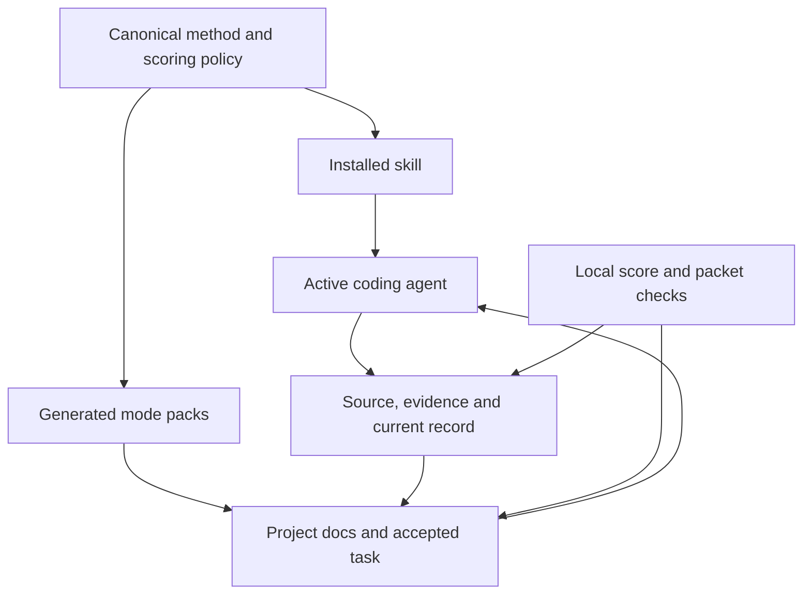
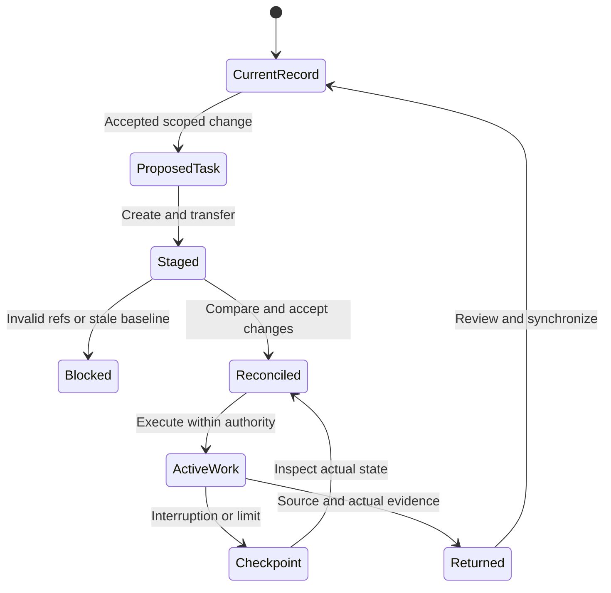

# Notch Lore — current product and release record

This record describes the Notch Lore 2.0.0 CLI, installable skill and three ChatGPT mode packs. The shared method lives in `skills/notchlore/references/`.

## Overview

Notch Lore helps a business owner move from a goal to coherent project knowledge, executable work and reviewed results. The owner should not translate chat history into technical prompts, reconstruct lost decisions or supervise every routine correction. The assistant develops the substantive project record; the executor works from a complete task and returns actual source/evidence. The reusable method serves existing applications and empty workspaces.

The name joins precise requirement fit with accumulated knowledge. Each applicable dimension must fit its stage threshold; other good dimensions cannot compensate. The selected numerical policy is an explicit review convention, not a calibrated measure of software quality or probability of success.

## Now, next and later

| Horizon | Outcome |
| --- | --- |
| Destination | Reusable business-to-engineering method with durable knowledge, useful execution and evidenced acceptance |
| Now | Production-target local package, three independent mode packs, deterministic scoring, safe selected-path transfer, protected updates and a complete manual/active-run workflow |
| Next | Close native Codex and physical platform qualification gaps; observe actual user workflows and repeated-project usefulness before expanding the method |
| Later | Integrate an existing authorized coordinator if it proves interruption recovery, ownership, budgets, duplicate/unknown-effect handling and permissions |

The release includes local tools and prompt packs. Hosted infrastructure, scheduled backups and deployment belong to the project using them.

## Release status

The local distribution is a release candidate. Production qualification is open. [VALIDATION.md](VALIDATION.md) records the checks run for this candidate and the environments still to be exercised.

## Users, value and economics

Primary user: a business owner explaining outcomes in ordinary language. Planning assistant: develops and reconciles the actual full/summary documents. Coding agent: inspects the real checkout, implements within authority, tests and returns evidence. Optional Dot: coordinates only through a real existing route. Deterministic tools: verify structure and bytes, not semantic truth.

Expected value is less manual context transfer, fewer repeated decisions and more reviewable delivery. Those are hypotheses pending real user observation; code and a few fixture trials do not establish demand, adoption or commercial savings. Current alternatives are ordinary Markdown/Git plus an established coding assistant. Notch Lore adds a reusable method, safe transfer and consistent assessment without replacing those tools.

The package is MIT and uses no runtime npm/pip dependencies. Node and Python are local prerequisites where stated. It creates no paid account, subscription or hosted infrastructure. Existing model-tool costs and entitlements belong to the user's actual environment; no ChatGPT subscription is assumed to grant API or VPS access. External publication is owner-authorized work; see PUBLICATION.md.

## Product and entry behavior

Bare invocation with no context asks one business question. Goal-only work starts a real named document and a useful recommendation. Existing code is inspected before claims about current behavior. Feature changes update affected goals/flows/access/contracts/economics/checks/horizon. Approved tasks proceed to the actual unfinished step. Returned results are compared against code and evidence. Audit-only requests remain read-only. Resume begins by reconciling current files, running ownership and unknown effects.

The valve selects understand, document/reconcile, develop, repair/refactor, qualify, operate, resume/handoff or finish/pause. It is not a compulsory menu. Target maturity, workflow state, change radius and horizon are independent. Questions use stable IDs and meanings, plain consequences and recommendations; routine technical decisions stay with the engineer. User-copied starters are at most 200 characters. Relevant references load progressively; small changes do not require all six long references.

Mode 1 develops records and reviews supplied evidence without Codex. Mode 2 uses first-class manual task/return exchange. Mode 3 uses the same contracts and falls back to a complete manual packet when Dot access is absent. Mode changes preserve accepted project records.

## Architecture and owners

| Owner | Responsibility |
| --- | --- |
| bin/notchlore.mjs | Argument routing, truthful output and exit status |
| lib/install.mjs | Owned skill receipts, safe installation and updates, locking and recovery copies |
| lib/inspect.mjs | Bounded read-only inventory and safe Git observations |
| lib/prompts.mjs | One-mode exports from canonical source, short starter, non-overwrite reservation |
| lib/aperture.mjs | Deterministic assessments, evidence validation and readable scorecards |
| skills/notchlore/references/aperture-rules.json | Sole machine owner of IDs, labels, type deductions and thresholds |
| skills/notchlore/references/METHOD.md | Plane-specific diagnostic rubrics, engineering semantics and convergence |
| Other five reference files | Conversation, context, system, handoff and executor responsibilities |
| lib/packet.py | Standard-library ZIP creation/validation/staging, portable paths, bounded records and privacy checks |
| lib/packet.mjs | Shell-free Python invocation and bounded result handling |
| scripts/ | Package/release verification and derived source/summary records |

There is no second active rules tree. Generated distribution copies are verified byte-for-byte. Source preservation, meaningful typed validation and existing tools take precedence over architectural novelty. File imports are untrusted data; they do not confer command, deployment or disclosure authority.

## Contracts, storage and lifecycle

Assessment JSON schema version 1 is defined in schemas/aperture.schema.json and the runtime validator. It records plane, scope/revision, candidate, environment, reviewer, goals, dimension criteria, evidence, findings and gates. Evidence has a local file, SHA-256 and explicit binding. Findings retain independent primary types, consequence, owner, correction, status and closure. Accepted/deferred findings still deduct while applicable. IDs and references must be coherent; unauthorized/silent scope weakening is rejected when checking a prior record.

The score is derived from active types once per dimension. Every applicable dimension must be adequately reviewed; otherwise it is UNKNOWN without a score. N/A is explicit and justified. Stale bindings or proof invalidate assessments. Mandatory gates require valid PASS evidence and authority; FAIL/BLOCKED/NOT RUN/INCONCLUSIVE do not pass. A document may pass while implementation is NOT RUN. The checker cannot establish truth, completeness of reported defects or whether a test actually ran.

Packet specification schema version 1 lives in schemas/packet.schema.json. Its kinds are source, task, return, checkpoint and selected-file backup. Required records include project/task identity, baseline, explicit selection, references/reading order, short entry, scope, authority/budget, exclusions and a review acknowledgement. Generated ZIPs contain START.md, manifest.json and payload/. Hashes bind exact bytes. Git HEAD, when required, is checked separately from working-file hashes. Dirty state is not inferred from a snapshot. Required local references are included; conventional Markdown links are mechanically checked, dynamic/code references require review.

Creation refuses occupied outputs. Checking does not execute files. Unpacking validates first and reserves a fresh staging directory; it never merges into live canonical paths. Canonical reconciliation is an explicit agent operation after source/baseline comparison. Empty projects use separate staging so the baseline remains meaningful. Any failure leaves existing application files intact; partial newly owned staging is reported for inspection rather than blindly reused.

## Access, trust and deployment

| Surface/actor | Allowed boundary |
| --- | --- |
| Local installer | Chosen project or user skill directory; only verified owned assets; no app edits |
| Inventory/scorer | Read the selected local root and allowed evidence; no source execution/network |
| Packet helper | Selected files and new output; default credential/private/live-data/cache exclusions; no payload execution |
| Planning/coding agent | Actual platform and task permissions; business acceptance is not broad deployment authority |
| Optional coordinator | Verified route, one run owner, scoped authority and budgets; no capability inferred from a name |
| Public distribution/crawlers | Only deliberately published reusable package material; no customer source or private records |
| Logged-in users/admin/service APIs | No new hosted surface or auth system in this package; existing platform controls apply |

The operating shape is local Node CLI plus Python ZIP helper when needed. No public port, API key, database, queue, Redis, CDN, Docker daemon or ingress change is required. Existing application/VPS topology is outside installer scope. Live services, shared gateways, foreign containers, certificates, volumes and credentials must be preserved. Registry or GitHub publication is separate from local packaging.

Intended runtime: Node >=22, Python 3 for packet/release operations. Physical verification is recorded per actual OS/version; a Linux run is not Windows/macOS proof. Missing Python fails packet commands clearly and leaves other commands available. Native skill discovery follows current official .agents/skills guidance, but native execution remains a separate gate from installation.

## Work clocks and continuity

Instant work is the foreground command or active model operation. It acknowledges complete local output or a precise failure. Queued/deferred clocks are design responsibilities for customer projects, not hidden background services in this package. No automatic accepted obligation survives the exit of these CLI tools. A model run is bounded by actual platform limits, task budget and no-progress policy.

The durable record retains task IDs, goals, stage/radius, accepted choices, revision/dirty state, permitted actions, actual run/session ID if available, proof, unknown effects, blockers and next action. A configured schedule is never reported as a completed backup.

Owned installer backups preserve previous source assets. Safe ZIPs are selected-file snapshots, not a consistent live-database backup or off-host restoration guarantee. Host-loss protection requires an independently recoverable copy under the application's actual policy. Restoration proof for this package is clean extraction/rehydration plus byte comparison and rerun checks; native session recovery has its own stated status.

## Performance and bounds

Explicit bounds protect local tools: inventory 4,000 entries/depth 6 with visible truncation; installer 1,000 files/8 MiB; assessment JSON 4 MiB, evidence 16 MiB per file and 64 MiB aggregate; packet 4,096 entries, 16 MiB/file, 64 MiB total and expansion guard. Transfer and evidence limits fail without silently dropping mandatory material. Packet/source selection can be split coherently or moved through an established authorized repository route.

Hashes require visiting selected bytes; linear work is appropriate. Sorting/path validation scales with selected entries; fixed 12-dimensional review is bounded. Performance tests must record actual cardinality, measured baseline/candidate, timing/resource conditions and preservation of all required records. No fixed universal SLA is claimed. Native model tokens/cost are reported only where observed, not estimated from file counts.

The package check limits the npm payload to 500 KB and 80 files, including the scorer, packet helper, schemas and examples. This is a release payload limit, not extra runtime dependencies. The installed skill remains a small entry with selective reference loading; copying the entire method into every task would waste context and is discouraged.

## Verification

[RELEASE_SCOPE.md](RELEASE_SCOPE.md) describes the supported workflows and the scope of local release checks. The package check enforces the payload budget and checks the generated summary. The release smoke test installs the local tarball in disposable workspaces, exercises the packaged commands and compares the rebuilt archives byte for byte.
