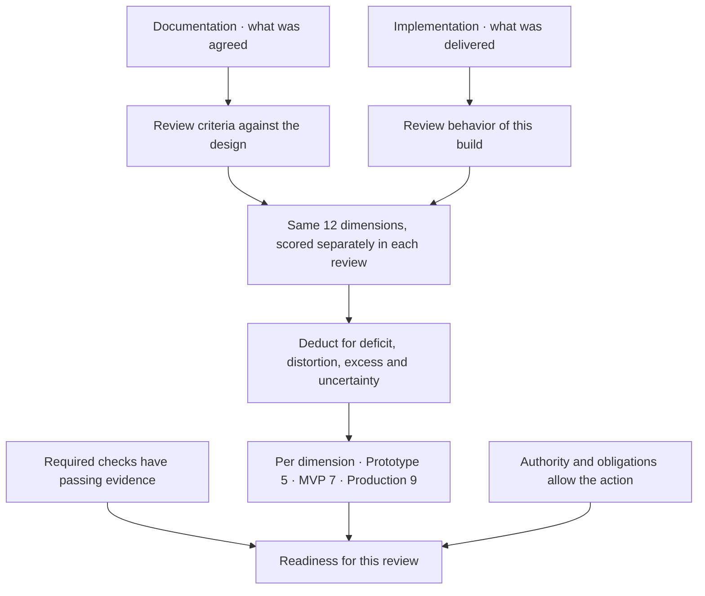

# Notch Lore

Plan a change in ChatGPT, hand it to Codex, and bring the changed files and test results back to the same conversation. A task ZIP carries the agreed work, the project version it belongs to, and the checks you expect to pass.

For example, the bundled text-counter task expects an empty project. Check it against an empty folder and it passes. Add `existing-app.txt` and check the same ZIP again. The command stops and names the file. You can catch a bad handoff before the agent edits anything. [Try the example](examples/use-cases/06-hand-off-a-task.md).

[Document an existing project](examples/use-cases/02-document-a-project.md) · [Design a feature](examples/use-cases/03-design-a-feature.md) · [Work through a UX decision](examples/use-cases/05-design-with-chatgpt.md) · [Refactor](examples/use-cases/10-refactor.md) · [All ten walkthroughs](examples/use-cases/README.md)

## Set up ChatGPT and Codex

**1. In ChatGPT.** Download the [ChatGPT + Codex pack](https://github.com/mx-dec0de/notchlore/raw/refs/heads/main/dist/notchlore-chatgpt-codex-2.0.0.zip) and attach it to a new ChatGPT chat. For existing software, add current project docs or a source snapshot you have reviewed for sharing. Send this, replacing the brackets with your goal.

```text
notchlore. Read START.md. Help me plan [change] and agree on how we will check it.
```

**2. In the IDE.** Open your **application project** in the IDE. In its terminal, install the skill. Use Node.js 22+ with npm. The packet commands also require Python 3.

```sh
npx --yes --package=notchlore@2.0.0 notchlore install --dir .
```

**3. Send the task.** When you approve the plan, ask ChatGPT for the **task ZIP, staging instructions and Codex starter**. Put that ZIP on the project machine. Open Codex in the same project and give it the supplied `$notchlore` starter and ZIP location. Codex checks the target, stages the task, and works through its acceptance checks.

**4. Review the return.** Upload the **return ZIP** to the original planning chat. Ask which requirements the changed files satisfy and which checks still need evidence.

For planning entirely in ChatGPT, attach the [ChatGPT-only pack](https://github.com/mx-dec0de/notchlore/raw/refs/heads/main/dist/notchlore-chatgpt-2.0.0.zip) and start at step 1. If you already use Dot to reach your project and Codex, the [Dot pack](https://github.com/mx-dec0de/notchlore/raw/refs/heads/main/dist/notchlore-chatgpt-codex-dot-2.0.0.zip) describes how to use that connection.

## What gets measured?



A design can pass while the implementation is still untested. [See the two radar charts, scoring rules and worked example](examples/assessment-guide.md).

[Setup and CLI guide](GUIDE.md) · [Validation history](https://github.com/mx-dec0de/notchlore/blob/main/VALIDATION.md) · [MIT license](https://github.com/mx-dec0de/notchlore/blob/main/LICENSE)
