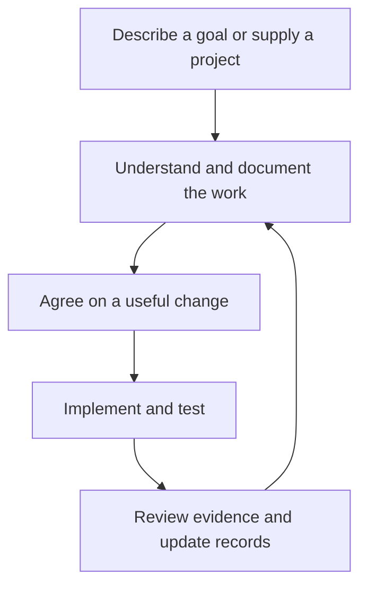

# Notch Lore

**Turn an idea into a plan, a coding task and a result you can check.**

Notch Lore is a project-development method for people working with ChatGPT and coding agents. It helps you describe an outcome, understand what already exists, maintain project decisions, hand work to an agent and review what actually changed.

It includes a Codex skill, three ChatGPT prompt packs and local tools for installation, project inspection, task packets and evidence-backed assessments.

[Start using it](#get-started) · [Choose a mode](#choose-a-mode) · [Explore use cases](#ten-ways-to-use-it) · [Read the full guide](GUIDE.md) · [Validation and limitations](VALIDATION.md)

## How it works



Start anywhere in the loop. You can explore an idea, review an existing application, carry out an approved task or resume interrupted work. A small request should stay small; the method does not require a full project review for every edit.

## Choose a mode

| Download from GitHub | Use it when |
| --- | --- |
| [ChatGPT only](dist/notchlore-chatgpt-2.0.0.zip) | You want to explore an idea, draw a workflow or review project material in ChatGPT. |
| [ChatGPT + Codex](dist/notchlore-chatgpt-codex-2.0.0.zip) | You want to plan in ChatGPT, implement in a local project with Codex and bring the results back for review. |
| [ChatGPT + Codex + Dot](dist/notchlore-chatgpt-codex-dot-2.0.0.zip) | You have an existing, authorized Dot connection to the project and Codex. |

On GitHub, follow the link for your mode and click **Download raw file** on the ZIP’s file page. Attach that one ZIP to a new ChatGPT conversation. For an existing project, also attach its current documents or a reviewed source snapshot. For a new project, a sentence about your goal is enough.

## Get started

### ChatGPT only

With the ChatGPT-only pack attached, send a goal in your own words. For example:

```text
notchlore. Read START.md. I want volunteers to organize community workshops. Help me choose the first version and sketch how a volunteer would use it.
```

Keep planning in that chat and download the project documents you want to keep. This mode needs no local installation.

### Install the Codex skill from npm

For either mode that uses Codex, open a terminal in the project where Codex will work. You need Node.js **22 or newer** with npm. The packet ZIP commands also require Python 3.

```bash
npx --yes --package=notchlore@2.0.0 notchlore install --dir /path/to/project
```

Replace `/path/to/project` with the existing project directory that you will open in Codex. Use `.` if you are already in that directory, or quote a path that contains spaces. The installer creates `.agents/skills/notchlore/` there with the skill instructions, references and an installation receipt.

The npm command uses version 2.0.0 published by `resultity`. The revised docs, repository metadata and downloadable packs here belong to the GitHub source. For a locally built tarball, see the [alternative install instructions](GUIDE.md#local-tarball-alternative).

### ChatGPT + Codex

1. With the ChatGPT + Codex pack attached, send `notchlore. Read START.md. Help me plan [goal] and define how we’ll check it.` Replace `[goal]` with the change you want.
2. Once you accept the plan, ask ChatGPT for the task ZIP, staging instructions and short Codex starter. Download the task ZIP and copy it to the project machine.
3. Follow the task’s `START.md` to check the project baseline and unpack into the fresh staging directory it names. Open Codex in the project, invoke `$notchlore` and give it the supplied starter with the staged task path.
4. Upload Codex’s return ZIP to the **same planning chat**. Ask ChatGPT to compare the changed files and test results with the accepted task. The [guide](GUIDE.md#4-transfer-an-approved-task) includes staging details and a runnable packet example.

### ChatGPT + Codex + Dot

With the Dot pack attached, replace `[goal]` and send:

```text
notchlore. Read START.md. Help me plan [goal]. Check whether Dot can reach my project, dispatch to Codex and return the results. If a step is unavailable, prepare the manual task packet.
```

Dot needs an existing, authorized connection. Once the plan is approved and the route verified, use it to deliver the task and collect the changes and evidence. If access is missing, use the ChatGPT + Codex steps above to carry the task out and bring the return ZIP back yourself.

## What it can help you do

- **Understand an existing project:** separate observed behavior from assumptions and proposed changes.
- **Develop a product:** describe users, workflows, constraints, alternatives and a useful next version.
- **Draw useful diagrams:** record relevant flows, architecture, ownership and dependencies in Markdown/Mermaid alongside precise text.
- **Prepare a cold handoff:** select files, describe the baseline and transfer a complete task to an agent without relying on chat history.
- **Implement and review:** connect requested changes to actual files, checks, evidence and remaining issues.
- **Assess readiness:** score 12 dimensions and record mandatory gates separately for documentation and implementation.
- **Continue interrupted work:** use a durable checkpoint and inspect actual state before resuming.

The scoring tool checks the assessment's structure, declared evidence and bindings. An assistant or reviewer still has to establish whether the evidence supports the conclusions. A score is not a percentage complete.

## Ten ways to use it

These prompts illustrate possible uses; they are not claims that every scenario has been independently tested.

1. **Shape an idea:** “I want to help people organize community workshops. Propose a useful first version.”
2. **Understand existing software:** “Study this project and explain what works, what is uncertain and what to improve first.”
3. **Develop one feature:** “Add saved roadmaps. Keep existing projects usable and define how we will verify the change.”
4. **Respond to a changed decision:** “Replace individual reminders with one daily summary. Update the affected requirements and checks.”
5. **Map a system:** “Show the user journey and the main components, including who can access which data.”
6. **Create a task for a coding agent:** “Prepare the approved version for Codex with the necessary context and acceptance checks.”
7. **Review delivered work:** “Compare the returned code and evidence against the accepted task, and identify gaps.”
8. **Assess readiness:** “Assess documentation and implementation separately. Show each dimension, findings and mandatory gates.”
9. **Resume a project:** “Read the checkpoint and inspect the current state before continuing the unfinished work.”
10. **Inspect a workspace:** Run `node bin/notchlore.mjs inspect /path/to/project` to locate project instructions, installed skills and uncommitted changes.

## Commands

| Command | Purpose |
| --- | --- |
| `install` | Install the skill or update a verified, unedited installation. |
| `inspect` | Inspect a project using a bounded read-only inventory. |
| `prompt` / `export` | Produce an entry prompt or a complete mode pack. |
| `score` | Validate and calculate an evidence-bound assessment. |
| `packet create/check/unpack` | Create, validate and stage a selected-file ZIP handoff. |

Run `node bin/notchlore.mjs --help` from the source directory for available commands. Examples are in [GUIDE.md](GUIDE.md), `examples/aperture/` and `examples/packet/`.

## Validation and boundaries

The release checks cover the local CLI, installer source and archive contents. Native Codex discovery, execution and session resumption still need a live test. See [VALIDATION.md](VALIDATION.md) for the environments, commands and results.

Notch Lore is a method and a set of local tools. It does not include an autonomous supervisor, recurring backup service, hosted Dot coordinator or remote execution bridge. It does not certify that generated designs, application code or security claims are correct.

## Contribute and build

```bash
npm test
npm run check
npm run release
```

The maintained skill is in `skills/notchlore/`; shared prompts are in `prompts/`. See [PUBLICATION.md](PUBLICATION.md) for the GitHub distribution and local build procedure.

Distributed under the [MIT license](LICENSE).
