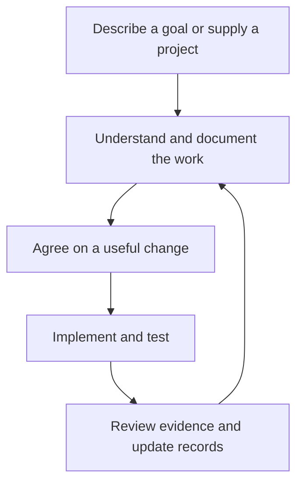

# Notch Lore

**Turn an idea into a plan, a coding task and a result you can check.**

Notch Lore is a project-development method for people working with ChatGPT and coding agents. It helps you describe an outcome, understand what already exists, maintain project decisions, hand work to an agent and review what actually changed.

It includes a Codex skill, three ChatGPT prompt packs and local tools for installation, project inspection, task packets and evidence-backed assessments.

[Start using it](#get-started) · [Choose a mode](#choose-a-mode) · [Explore use cases](#ten-ways-to-use-it) · [Read the full guide](GUIDE.md) · [Validation and limitations](VALIDATION.md)

## How it works



Start anywhere in the loop. You can explore an idea, review an existing application, carry out an approved task or resume interrupted work. A small request should stay small; the method does not require a full project review for every edit.

## Choose a mode

| Mode | Use it for | What you need |
| --- | --- | --- |
| **ChatGPT** | Develop an idea, plan a project, make diagrams or review material in ChatGPT. | The ChatGPT mode ZIP. |
| **ChatGPT + Codex** | Plan in ChatGPT, implement in Codex, then review the return. | The ChatGPT + Codex ZIP and the installed Codex skill. |
| **ChatGPT + Codex + Dot** | Coordinate the same loop through an existing, verified Dot connection. | The Dot mode ZIP and actual authorized tools. If they are unavailable, use the manual handoff. |

Download one pack: [ChatGPT](dist/notchlore-chatgpt-2.0.0.zip) · [ChatGPT + Codex](dist/notchlore-chatgpt-codex-2.0.0.zip) · [ChatGPT + Codex + Dot](dist/notchlore-chatgpt-codex-dot-2.0.0.zip). On GitHub, open the ZIP and click **Download raw file**, then attach it to your planning chat.

## Get started

### Plan in ChatGPT

Upload `notchlore-chatgpt-2.0.0.zip`. For an existing project, also attach current documentation and a reviewed source snapshot. Then send:

```text
notchlore. Read START.md. Here is my project. Help me understand it and choose the next useful improvement.
```

For ChatGPT + Codex, use `notchlore-chatgpt-codex-2.0.0.zip` instead. Explain the outcome you want; you do not need to provide an architecture or select a database first.

### Install the Codex skill

Requires Node.js **22 or newer**. Python 3 is needed for the packet ZIP commands. From the extracted release's `notchlore/` directory:

```bash
npx --yes --package=./dist/notchlore-2.0.0.tgz notchlore install --dir /path/to/project
```

Open Codex in that project and send:

```text
$notchlore Help me understand this project and recommend the next useful step.
```

The installer creates `.agents/skills/notchlore/` in the selected project. Installing it does not connect ChatGPT to your machine, create a background service or start an agent. To update an unedited Notch Lore skill, use the newer tarball with `install --update`. The installer reports where it saved the previous copy.

### Move work between ChatGPT and Codex

1. In ChatGPT, develop and accept a specific change.
2. Ask for a complete task packet and its placement instructions.
3. Transfer the packet to the project machine and follow its `START.md` to validate and stage it. Do not extract it over live project files.
4. In Codex, activate `$notchlore` and ask it to carry out the staged task within the accepted scope.
5. Transfer the return to ChatGPT for review and reconciliation.

See [GUIDE.md](GUIDE.md) for staging requirements, packet limits and recovery. Uploading a ZIP to ChatGPT does not place it on your computer; installing the skill does not give ChatGPT access to your files.

## What it can help you do

- **Understand an existing project:** separate observed behavior from assumptions and proposed changes.
- **Develop a product:** describe users, workflows, constraints, alternatives and a useful next version.
- **Draw useful diagrams:** record relevant flows, architecture, ownership and dependencies in Markdown/Mermaid alongside precise text.
- **Prepare a cold handoff:** select files, describe the baseline and transfer a complete task to an agent without relying on chat history.
- **Implement and review:** connect requested changes to actual files, checks, evidence and remaining issues.
- **Assess readiness:** score 12 dimensions and record mandatory gates separately for documentation and implementation.
- **Continue interrupted work:** use a durable checkpoint and inspect actual state before resuming.

The scoring tool checks the assessment's structure, declared evidence and bindings. An assistant or reviewer still has to establish whether the evidence supports the conclusions. A score is not a percentage complete.

## Ten ways to use it

These prompts illustrate possible uses; they are not claims that every scenario has been independently tested.

1. **Shape an idea:** “I want to help people organize community workshops. Propose a useful first version.”
2. **Understand existing software:** “Study this project and explain what works, what is uncertain and what to improve first.”
3. **Develop one feature:** “Add saved roadmaps. Keep existing projects usable and define how we will verify the change.”
4. **Respond to a changed decision:** “Replace individual reminders with one daily summary. Update the affected requirements and checks.”
5. **Map a system:** “Show the user journey and the main components, including who can access which data.”
6. **Create a task for a coding agent:** “Prepare the approved version for Codex with the necessary context and acceptance checks.”
7. **Review delivered work:** “Compare the returned code and evidence against the accepted task, and identify gaps.”
8. **Assess readiness:** “Assess documentation and implementation separately. Show each dimension, findings and mandatory gates.”
9. **Resume a project:** “Read the checkpoint and inspect the current state before continuing the unfinished work.”
10. **Inspect a workspace:** Run `node bin/notchlore.mjs inspect /path/to/project` to locate project instructions, installed skills and uncommitted changes.

## Commands

| Command | Purpose |
| --- | --- |
| `install` | Install the skill or update a verified, unedited installation. |
| `inspect` | Inspect a project using a bounded read-only inventory. |
| `prompt` / `export` | Produce an entry prompt or a complete mode pack. |
| `score` | Validate and calculate an evidence-bound assessment. |
| `packet create/check/unpack` | Create, validate and stage a selected-file ZIP handoff. |

Run `node bin/notchlore.mjs --help` from the source directory for available commands. Examples are in [GUIDE.md](GUIDE.md), `examples/aperture/` and `examples/packet/`.

## Validation and boundaries

The release checks cover the local CLI, installer source and archive contents. Native Codex discovery, execution and session resumption still need a live test. See [VALIDATION.md](VALIDATION.md) for the environments, commands and results.

Notch Lore is a method and a set of local tools. It does not include an autonomous supervisor, recurring backup service, hosted Dot coordinator or remote execution bridge. It does not certify that generated designs, application code or security claims are correct.

## Contribute and build

```bash
npm test
npm run check
npm run release
```

The maintained skill is in `skills/notchlore/`; shared prompts are in `prompts/`. See [PUBLICATION.md](PUBLICATION.md) before publishing a release.

Distributed under the [MIT license](LICENSE).
