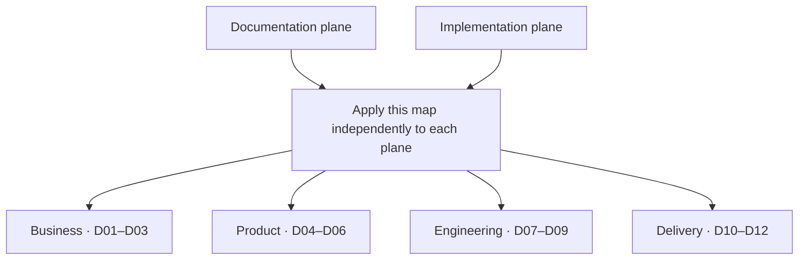
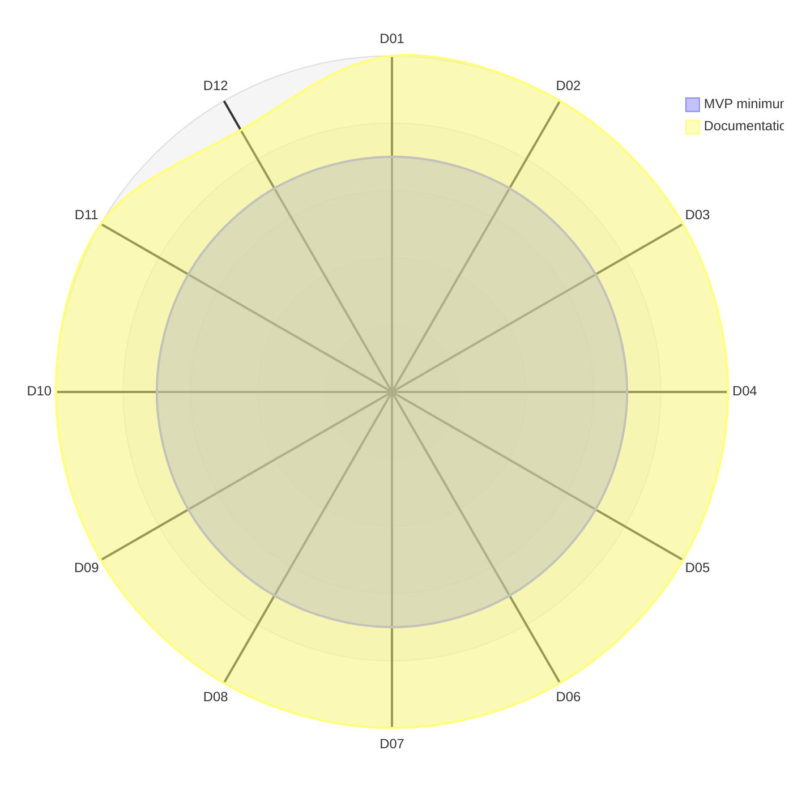
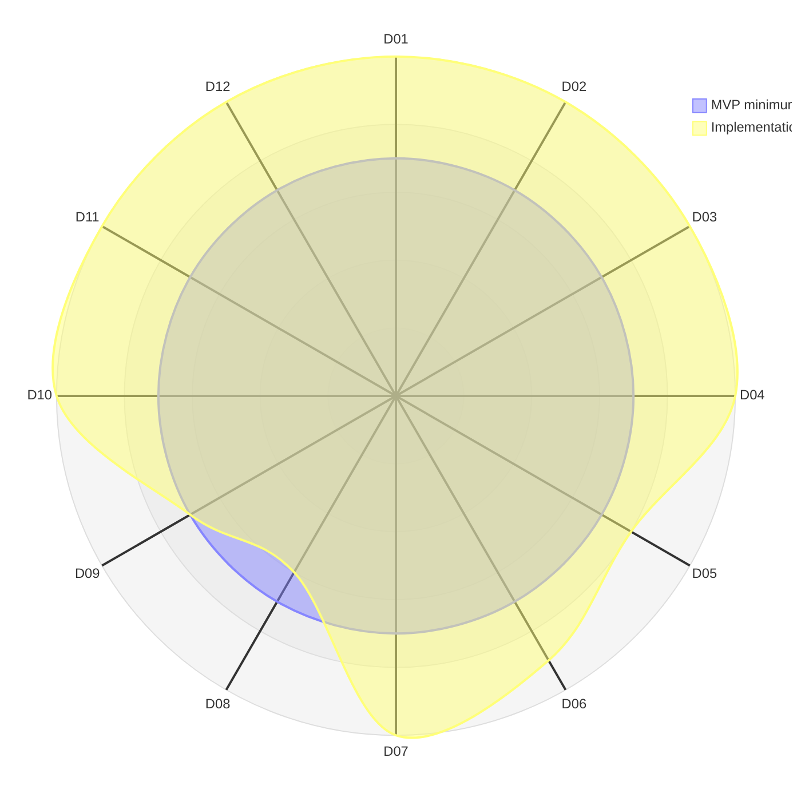

# Reading an assessment

Start with a question small enough to answer. Suppose a roadmap editor must open projects saved by its previous version. A reviewer can inspect the design for a compatibility rule. To assess implementation, the reviewer also needs the identified build, an old project file and the result of opening it.

Notch Lore calls these the **documentation** and **implementation** planes. Each has its own assessment for a named scope, revision, candidate, environment and stage. The same twelve dimensions apply to both. Evidence for a written decision can support the documentation review while the corresponding implementation check is still waiting to run.

## Two planes, four groups, twelve dimensions



| Group | Dimension | A question the reviewer can answer |
| --- | --- | --- |
| Business | D01 Business value | Who benefits, and what observable outcome matters to them? |
| Business | D02 Scope and evolution | Which change belongs in this version? |
| Business | D03 Economics and obligations | Who pays for it and what commitments follow? |
| Product | D04 Features and experience | Can the user complete the promised task? |
| Product | D05 Flows and lifecycle | What happens on retry, cancellation or interruption? |
| Product | D06 Access and trust | Who may see the data or perform the action? |
| Engineering | D07 Architecture and code | Which component owns the behavior? |
| Engineering | D08 Contracts and storage | Which fields and formats must survive a write and read? |
| Engineering | D09 Integration and compatibility | Which older files, clients or integrations must keep working? |
| Delivery | D10 Deployment and operations | How will the operator release and recover this version? |
| Delivery | D11 Performance and reliability | What workload and failure conditions have been checked? |
| Delivery | D12 Verification and continuity | Can another person trace the result to the build and resume the work? |

## Score projections

Here is an illustrative MVP review of the roadmap importer. Each spoke is one dimension from the table. The two charts use the same order and 0–10 scale. The MVP line marks 7 on every spoke. Read individual scores against that line.

### Documentation

The design has one unresolved review question in D12, so it scores 9 there. The remaining dimensions in this example score 10.



### Implementation

The dips show which parts of the implementation need work and how far each falls. The table explains what caused the deductions.



| Dimension | Finding in this example | Deduction | Score |
| --- | --- | ---: | ---: |
| D05 Flows and lifecycle | Import asks for the same confirmation twice. | EXC −2 | 8 |
| D06 Access and trust | A specific access claim remains unverified after review. Its mandatory check is still unrun. | UNC −1 | 9 |
| D08 Contracts and storage | The saved file is missing a required format-version field. | DEF −4 | 6 |
| D09 Integration and compatibility | Two supported formats reorder milestones. Both findings are distortions. | DIS −3 once | 7 |

The implementation falls below the MVP minimum at D08. Its unrun access check also blocks readiness. The score projections are illustrative. In a real review, keep UNKNOWN and N/A in the assessment table without inventing numbers for the chart.

## How a dimension gets a score

Start at 10 after the applicable criteria have been assessed. Subtract each active type once per dimension in that plane. Keep every finding visible, including accepted and deferred findings that still apply.

| Type | Deduction | What earns it |
| --- | ---: | --- |
| DEF · Deficit | 4 | Something required is missing or incomplete. |
| DIS · Distortion | 3 | Something present behaves differently from the agreed requirement. |
| EXC · Excess | 2 | Something unnecessary creates demonstrable work, cost or complexity. |
| UNC · Uncertainty | 1 | A specific claim still lacks adequate evidence after the dimension was assessed. |

Fixing one of the two D09 distortions leaves the score at 7. The deduction clears once both fixes are verified. An independently evidenced excess in D09 would deduct a further two points while active.

An unassessed dimension is **UNKNOWN** and has no score. A dimension outside scope can be **N/A** with a recorded reason. A blank list of findings supplies no assessment.

## When a plane passes

| Target stage | Minimum for each applicable dimension |
| --- | ---: |
| Prototype | 5 |
| MVP | 7 |
| Production | 9 |

Every applicable dimension must reach the stage minimum. Each applicable mandatory check must also have valid passing evidence, and authority and applicable obligations must permit the action. In the importer example, D09 at 7 reaches the MVP numeric minimum, yet a failed mandatory import check still blocks acceptance. The weights are review conventions. A one-point uncertainty can block a release when it concerns a mandatory check.

## Try both fixture records

From the Notch Lore source directory, run the commands separately.

```sh
node bin/notchlore.mjs score examples/aperture/assessment.json --root examples/aperture
node bin/notchlore.mjs score examples/aperture/runtime-not-run.json --root examples/aperture
```

The synthetic documentation fixture exits 0. The runtime fixture exits 2 with `NOT RUN` and unknown dimensions. Exit 1 indicates invalid input or structure. The scorer checks local evidence bytes, references and their declared bindings. A reviewer still has to read the evidence and decide what it establishes.

The [machine policy](../skills/notchlore/references/aperture-rules.json) defines the weights, stages and dimension names. The [method](../skills/notchlore/references/METHOD.md) gives criteria for both planes.
