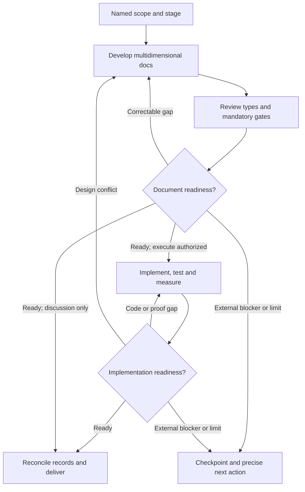
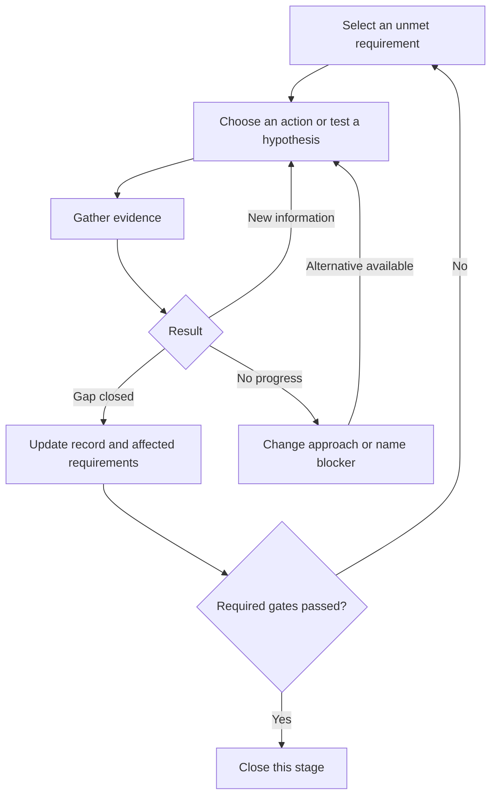

# Notch Lore method and Aperture

Use this shared method to develop an actual project record, review its combined fit, and finish a bounded accepted outcome. Select relevant detail; twelve dimensions are views of one project, not twelve mandatory documents or a customer questionnaire. [CONVERSATION.md](CONVERSATION.md) owns the owner dialogue; [CONTEXT.md](CONTEXT.md) owns current records; [SYSTEM.md](SYSTEM.md) owns operating detail; [HANDOFF.md](HANDOFF.md) owns transfer; [CODEX.md](CODEX.md) owns active execution.

## Contents

- [Dimensions](#twelve-dimensions-in-four-quadrants) and [independent deductions](#four-independent-types-fixed-deductions)
- [Documentation rubric](#documentation-rubric) and [implementation rubric](#implementation-rubric)
- [Thresholds and mandatory gates](#stage-thresholds-and-mandatory-gates), [two planes](#two-assessment-planes-and-the-correction-loop), [one ledger](#one-goal-and-evidence-record)
- [Document convergence](#develop-the-record-until-it-fits) and [responsibilities](#author-reviewer-and-supervisor)
- [Horizon](#keep-four-planning-distances), [routes](#three-ways-to-change-the-project), [radii](#three-radii-of-completeness)
- [Engineering](#engineering-principles), [data](#concise-durable-data), [patterns](#patterns-that-earn-their-place), [performance](#performance-and-complexity)
- [Estimates](#honest-estimates), [correction loop](#the-reasoning-and-self-check-loop), [stop conditions](#metrics-and-the-stopping-boundary)

The Aperture is a review policy, not a claim of calibrated quality or a promise that a model will find every defect. Numeric/type policy is maintained in [aperture-rules.json](aperture-rules.json); the CLI derives scores from assessed findings, checks declared structure and evidence bindings, and renders the scorecard. It does not certify the truth of attached evidence. Prompt-only and executed guarantees must remain distinct.

## Twelve dimensions in four quadrants

Use **12 stable dimensions, four independently assessed deviation types, and two assessment planes**. These dimensions are views of one project, not twelve subsystems or twelve required documents. Each relevant goal links to the dimensions it affects. Inspect applicability once, reuse still-valid evidence, and revisit affected dimensions when goals, source, environment or evidence change. The assistant does this work; the owner does not answer a 48-cell technical questionnaire.

| Quadrant | ID | Dimension | Coverage when applicable |
| --- | --- | --- | --- |
| Business | D01 | Business value | Problem, intended benefit, people and stakeholders, market alternatives, differentiator, adoption/distribution, value hypotheses, measurement and non-goals. |
| Business | D02 | Scope and evolution | Accepted feature boundaries, Destination/Now/Next/Later, dependencies and critical path, priorities, extensibility, deprecation, change authority and exclusions. |
| Business | D03 | Economics and obligations | Development/operating cost, budget, pricing and unit economics, resources, licenses, contracts, privacy/legal obligations, retention commitments and commercial risk. |
| Product | D04 | Features and experience | Complete capabilities and supported variants; human interfaces, onboarding, usability, accessibility/localization, meaningful status/errors and user-visible results. |
| Product | D05 | Flows and lifecycle | End-to-end states and terminal outcomes, exceptions, interruption/retry/cancel/duplicate handling, concurrency/ownership, durable obligations and the three work clocks. |
| Product | D06 | Access and trust | Actors/actions/resources, public/private surfaces, authentication/authorization, tenant boundaries, scoped secrets, revocation, privacy, abuse/usage limits and security proof. |
| Engineering | D07 | Architecture and code | Domains, responsibilities, dependency direction, semantic reuse, code clarity, configuration, justified patterns, targeted refactoring and removal of replaced paths. |
| Engineering | D08 | Contracts and storage | Typed formats, complete fields/units/states/errors, canonical vocabulary, authoritative data, keys/constraints/transactions, migrations, projections, freshness and all producers/consumers. |
| Engineering | D09 | Integration and compatibility | Existing tools/libraries/services, interfaces and adapters, API/protocol versions, prerequisite lifecycle, OS/hardware/browser support, backward compatibility and interoperability. |
| Delivery | D10 | Deployment and operations | Local/VPS/external topology, installation/configuration, ingress/DNS/TLS/CDN, release/activation, logs/monitoring, maintenance, timed backups, restore/rollback procedures and owner setup. |
| Delivery | D11 | Performance and reliability | Workload/cardinality, time/space growth, queries, latency/throughput/resources/cost, bounds/backpressure/fairness, failure tolerance, availability and measured recovery objectives. |
| Delivery | D12 | Verification and continuity | Goal-to-proof traceability, current documentation, test and real integration evidence, reproducible candidate/environment identity, decisions, task/session checkpoints, handoff and resumption. |

Ownership removes overlap: a backup's operating procedure belongs in D10, its recovery target and measured behavior link to D11, and its evidence record links to D12. Do not maintain three conflicting backup specifications. The same rule applies to access, formats, clocks and performance. Every applicable criterion has one authoritative home and may have multiple impact links.

## Four independent types, fixed deductions

The aperture metaphor: every dimension is an opening; deviations reduce clearance; the stage's rod must pass **every** applicable opening. Other dimensions cannot compensate for one failed opening. Mandatory gates are additional obstructions and must remain visible even when a numeric score is high. This is a review model, not a literal geometry calculation or a claim that four sector radii should be summed physically.

| Type | Meaning | Fixed deduction | Remedy |
| --- | --- | ---: | --- |
| DEF — Deficit | An applicable expected element is absent or incomplete. | 4 | Complete |
| DIS — Distortion | An existing element contradicts its required meaning, behavior or constraints. | 3 | Correct |
| EXC — Excess | An existing element causes demonstrably unnecessary complexity, work, cost or maintenance. | 2 | Simplify |
| UNC — Uncertainty | Assessment identifies a specific relevant claim whose support remains missing, stale or inconclusive. | 1 | Establish evidence |

For an assessed dimension in one plane:

`score = 10 - 4*DEF - 3*DIS - 2*EXC - 1*UNC`

Each flag is 0 or 1. Derive flags from the active findings; do not let the assistant type an unsupported score or independent flag values. Apply each type **once per dimension**, regardless of its number of findings. Keep every finding and its effect visible. A type clears only when all its applicable findings are resolved or an explicit scope change makes them inapplicable. Merely deferring or accepting a finding does not remove its deduction while it remains applicable.

**No cascade:** DIS does not imply EXC or UNC. A missing feature normally activates DEF; its inability to run or be tested does not automatically create three more deductions. Separate demonstrated problems can activate several types in the same dimension. Give a finding one primary type; link independent consequences by cause rather than cloning the same claim. One cause may affect multiple dimensions, but each effect needs its own applicable criterion and evidence. Correct the cause and recheck the linked effects.

A concrete evidence boundary: if an automated verifier is itself required but absent, classify that missing mechanism as DEF. If the verifier exists but has not run, classify the unsupported result as UNC. Do not add a second finding merely saying that the absent verifier cannot run. Link the affected mandatory gate, which remains unpassed in either case; separately evidenced implementation problems still receive their own findings. Test this distinction in the scorer fixtures.

These weights classify deviation types; they do **not** rank consequence or danger. A security UNC can be release-blocking, while a nonessential display omission may have small consequences. Record consequence and mandatory status separately; prioritize repairs by actual impact and dependency, not the larger numeric deduction. Do not silently revert to severity-based or per-finding scoring.

Only score gaps against applicable criteria, accepted outcomes or evidenced constraints. Personal taste, conceivable future improvements and speculative scale are not automatic deviations. Necessary validation at two trust boundaries is not EXC merely because code looks similar. Out-of-scope future features are not DEF. New material risks become explicit findings and design decisions rather than hidden requirements.

**UNKNOWN is different from UNC.** If a dimension or its four types have not been sufficiently assessed, show UNKNOWN with no numeric score. An absent finding list is not a completed review. UNC is a bounded identified gap after an adequate assessment of the other types. An entirely untested candidate cannot obtain 9 everywhere by calling all missing knowledge UNC. If the available evidence supports assessment of all four types, show the derived score and its evidence limits. Missing mandatory runtime checks still block acceptance. Otherwise show UNKNOWN without a numeric score. N/A requires a scoped reason and reassessment when scope changes. Stale or invalidated assessments return to UNKNOWN until rechecked.

The score deliberately loses information: one deficit and twenty deficits both deduct four. Therefore always show **score + active types + open finding count + mandatory gate status**. Show resolved and remaining work, not a number alone. The score is a policy index, not percentage complete, probability of success, certification or calibrated software-quality measurement.

## Documentation rubric

The tables are diagnostic rubrics, not a list of universal defects to invent. Apply each to the named project scope and document revision. A row's examples do not replace its full coverage in the dimensions table above.

| Dimension | DEF: absent/incomplete | DIS: inconsistent/wrong | EXC: unnecessary | UNC: unsupported/unclear |
| --- | --- | --- | --- | --- |
| D01 Business value | Beneficiary, problem, desired benefit or success criterion missing. | Proposed outcome addresses the wrong problem or conflicts with accepted business intent. | Low-value goals or repeated strategy text obscure the decision. | Relevant value/demand assumption has no adequate basis or validation plan. |
| D02 Scope and evolution | Current boundary, horizon, prerequisite or preserved behavior missing. | Priorities, dependencies, stage or promised scope contradict one another. | Scope creep or speculative future architecture burdens the current stage. | A relevant dependency or future compatibility commitment remains unresolved. |
| D03 Economics and obligations | Required cost/resource/license/commercial obligation omitted. | Cost model, resource plan or obligation interpretation conflicts with actual constraints. | Unjustified subscription, infrastructure or approval burden. | Material price, entitlement, license or obligation premise is unverified. |
| D04 Features and experience | Required capability, variant, actor journey or usable outcome unspecified. | Interface or behavior specification contradicts the user's accepted need. | Features or interaction steps add no justified value. | Important usability, accessibility or adoption assumption lacks support. |
| D05 Flows and lifecycle | State, terminal result, exception, durable obligation or clock responsibility missing. | State transition, timing, ownership, retry or cancellation rules conflict. | Redundant states, processing paths or coordination add no required behavior. | Ordering, failure or external-effect assumption remains unresolved. |
| D06 Access and trust | Required actor permission, exposure boundary, retention or protection rule absent. | Permissions, privacy promise or trust boundary contradict one another. | Unnecessary exposure, privileges or authentication friction. | Relevant security/provider assumption or permission decision lacks adequate support. |
| D07 Architecture and code | Required responsibility, owner or dependency boundary unspecified. | Wrong ownership, dependency direction or abstraction contradicts the design's needs. | Duplicate owners, speculative layers or unnecessary rewrite. | Reuse, change impact or architectural feasibility not sufficiently investigated. |
| D08 Contracts and storage | Required field, unit, invariant, authority, migration or lifecycle unspecified. | Formats, state meanings, sources of truth or producer/consumer rules disagree. | Redundant durable facts, representations or generalized schema machinery. | Integrity, capacity or migration assumption lacks evidence or a resolving plan. |
| D09 Integration and compatibility | Required interface, version, platform or prerequisite lifecycle omitted. | Incompatible contract, version or support promise. | Unnecessary adapter, dependency, compatibility wrapper or external service. | Required provider/platform behavior or access has not been verified. |
| D10 Deployment and operations | Install/configuration/release/maintenance/backup/restore path missing. | Topology or procedure conflicts with the actual host, authority or operating promise. | Avoidable services, exposed entrypoints or operator chores. | Material environment, privilege, scheduling or restoration premise is unverified. |
| D11 Performance and reliability | Relevant workload, bounds, resource or recovery criteria missing. | Proposed work/algorithm/failure model cannot meet the declared constraints. | Unnecessary scans, fanout, polling, observation or premature scaling in the design. | Capacity, failure tolerance or key algorithmic premise lacks adequate support. |
| D12 Verification and continuity | Goal/check/evidence mapping, current record, handoff or recovery plan missing. | Contradictory criteria, stale facts presented as current, or planned proof labeled executed. | Duplicate manuals, ritual review loops or checks without useful coverage. | A claimed fact, decision or baseline has insufficient provenance. |

## Implementation rubric

Assess the actual candidate and environment, including its user-visible and operational effects. Business outcomes requiring later observation remain explicitly unproven; code alone does not establish demand, adoption or savings.

| Dimension | DEF: absent/incomplete | DIS: inconsistent/wrong | EXC: unnecessary | UNC: unsupported/unclear |
| --- | --- | --- | --- | --- |
| D01 Business value | Delivered slice lacks the promised useful outcome. | Actual behavior serves a different problem or intended audience. | Implemented low-value work adds burden without the agreed benefit. | Claimed business benefit has not been established by appropriate observation. |
| D02 Scope and evolution | Accepted current item or necessary extension/migration path missing. | Delivered scope or dependencies conflict with the accepted plan. | Unrequested expansion or speculative foundation displaces current delivery. | Impact on a declared later compatibility need remains unexamined. |
| D03 Economics and obligations | Required cost control, license condition or obligation absent. | Actual billing/resource/retention behavior violates the declared policy. | Avoidable paid services, resource consumption or operating burden. | Cost/license/obligation compliance claim lacks required evidence. |
| D04 Features and experience | Required feature, variant or usable interaction missing. | Feature behaves incorrectly or creates a misleading/confusing outcome. | Unnecessary functionality, clicks or duplicated interface paths. | Important usability/accessibility behavior remains unverified. |
| D05 Flows and lifecycle | Dead end, dropped accepted work, missing terminal/failure/recovery path. | Incorrect state, race, clock, cancellation, replay or side-effect behavior. | Redundant processing or coordination without justified effect. | Relevant interruption, ordering or external-effect behavior remains unverified. |
| D06 Access and trust | Required access check, isolation, secret handling or protection missing. | Wrong actor can act/read, or implemented policy violates the intended boundary. | Unnecessary privilege, exposure or sign-in steps. | Mandatory security/privacy behavior lacks adequate proof. |
| D07 Architecture and code | Necessary responsibility or owned implementation incomplete. | Incorrect ownership/coupling/configuration or incompatible abstraction. | Duplicate business logic, scattered policy, dead code or needless abstraction. | Impact, ownership or caller coverage remains unresolved after inspection. |
| D08 Contracts and storage | Required data/format/migration/producer/consumer support absent. | Inconsistent schemas, units, state meanings, writes or competing authorities. | Redundant storage, representations, serializers or derived truth. | Integrity, migration, reconciliation or freshness claim is unverified. |
| D09 Integration and compatibility | Promised integration, supported environment or upgrade path missing. | Actual incompatible protocol/version/provider/platform behavior. | Unnecessary adapters, dependencies or retained replacement implementations. | Required real integration or platform qualification remains unproven. |
| D10 Deployment and operations | Promised installation, release, backup or operating mechanism absent. | Wrong effective config/topology, broken schedule or unsafe release/recovery procedure. | Excess infrastructure, public endpoints or recurring manual work. | Actual deployment, scheduled execution or restore capability is unverified. |
| D11 Performance and reliability | Required capacity, bound, durability or recovery mechanism missing. | Measured bottleneck, race, starvation or failure violates the agreed target. | Avoidable computation, queries, allocations, polling or observation overhead. | Required load, tail latency, durability or recovery result unmeasured. |
| D12 Verification and continuity | Required tests, current records, evidence, handoff or checkpoint mechanism absent. | False result, stale documentation or evidence attached to the wrong candidate. | Redundant checks/docs/review loops that do not improve relevant assurance. | A specific completion or continuity claim remains unsupported or inconclusive. |

## Stage thresholds and mandatory gates

| Stage | Minimum in every applicable assessed dimension | Typical declared promise |
| --- | ---: | --- |
| Prototype | 5/10 | A bounded experiment or small real journey, with explicit environment, exposure and exclusions. |
| MVP | 7/10 | A small complete useful product for named users and flows, with necessary access, persistence and operating conditions. |
| Production | 9/10 | The stated operational promise, supported by the required correctness, security, compatibility, load and recovery evidence. |

These are the declared stage policy. They are score thresholds, not percent of features complete or probability of reliability. Name maturity and current workflow state. Apply thresholds to the active plane's exact scope; never average dimensions or the two planes into acceptance.

The active plane passes only if **every applicable dimension is assessed and meets its stage threshold, every applicable mandatory gate has valid PASS evidence, and no authority or applicable non-waivable obligation blocks the action**. FAIL, BLOCKED, NOT RUN and INCONCLUSIVE do not pass. An applicable UNKNOWN dimension blocks acceptance. A required but unavailable environment remains an unpassed gate; continue independent authorized work.

A mandatory missing feature can leave a numeric 6 but still block a prototype. Unverified required security can leave 9 but still block production. Untested restoration cannot pass merely because all documents exist. Unknown business adoption need not block a properly scoped experiment if adoption is explicitly a post-launch hypothesis with a validation plan; it cannot be described as already achieved.

Only an explicit authorized change to an eligible scope, stage or promise can shrink the rod. Record before/after, rationale and consequences, create a new assessment and retain the old result. Do not lower weights, silently relabel mandatory checks, erase findings, accept a partial scenario as complete, or use N/A to escape a failed requirement. Applicable authority/privacy/legal obligations cannot be waived by a prototype label. A tolerated nonmandatory gap stays visible and cannot be closed without resolution or a legitimate applicability change.

The fixed type policy has deliberate tradeoffs:

| Active types | Score | Numerical eligibility before mandatory gates |
| --- | ---: | --- |
| None, all types reviewed | 10 | Prototype, MVP, Production |
| UNC | 9 | Prototype, MVP, Production |
| EXC | 8 | Prototype, MVP |
| DIS | 7 | Prototype, MVP |
| EXC + UNC | 7 | Prototype, MVP |
| DEF | 6 | Prototype |
| DEF + UNC | 5 | Prototype |
| DEF + DIS + EXC + UNC | 0 | None |

Production therefore permits a nonmandatory bounded uncertainty while rejecting a qualifying excess. This does not mean uncertainty is less dangerous. Keep the limits of type-based scoring explicit and let mandatory criteria/evidence control consequence. Do not claim mathematical optimality or calibrated safety from the weights.

## Two assessment planes and the correction loop

| Plane | Question | Appropriate evidence |
| --- | --- | --- |
| Documentation/design | Is this target coherent, complete enough to execute, traceable and feasible for the named assignment? | Source-backed current map, accepted decisions or explicit safe assumptions, complete relevant flows/contracts/owners, rationale, dependencies and measurable checks. |
| Implementation/runtime | Does this exact candidate implement and demonstrate the promised behavior in its supported environment? | Actual source/diff, tests/integration/load/operating results, preserved flows, artifact/environment identity, security/recovery evidence and explicit limitations. |

A sound design can be ready to build while implementation is NOT RUN. Runtime tests that are deliberately part of the build do not automatically reduce a design score. Missing proof blocks design when it is needed to justify a design premise, resolve a contradiction or establish feasibility. Equally, a beautiful specification cannot turn an untested implementation into PASS. Keep observed current state and proposed target separately identified; do not assign the target's score to the current code.

Author develops, Reviewer challenges fit and proof, Supervisor selects the most consequential correction. Use real separate agents when available and useful, or explicit self-review passes without claiming independence. Protect settled decisions, recheck affected dimensions after changes, and stop optional polish at the agreed gate. If two passes produce no useful new evidence or correction, change hypothesis/approach; if still blocked, checkpoint the cause and continue independent work. This is a process contract, not a running service or a guarantee that every goal set is feasible.

## One goal and evidence record

Use one authoritative goal/gate/finding/decision record with generated summaries. Conventional Markdown and a small JSON representation are sufficient where deterministic checks are valuable; reuse existing project records rather than install a second task manager. [aperture-rules.json](aperture-rules.json) owns the stable IDs, names, deductions and stage thresholds used by the scorer; this document owns the diagnostic prose and rubrics. Generated scorecards/fixtures do not become competing specifications.

- **Goal:** stable ID, outcome/business rationale, owning dimension and impact links, horizon/stage, priority/mandatory status, owner, authoritative design/contract reference and acceptance criteria.
- **Assessment:** document revision or candidate identity, scope/environment, stage, applicability reason, reviewed/unknown state, coverage/evidence references and reviewer/pass identity. All four types must be reviewed before a score is assigned.
- **Finding:** stable ID, affected criterion/dimension/plane, one primary type, observed gap, evidence/source or precise unknown, consequence, mandatory gate link, correction, owner, status and closure/recheck evidence. Link common causes and cross-dimensional effects. Retain every distinct finding even after a type's deduction is saturated.
- **Gate:** relevant goals, mandatory flag, candidate/environment, method, fixture/workload, expected state or metric/threshold, result, evidence locator and validity. Results: PASS / FAIL / BLOCKED / NOT RUN / INCONCLUSIVE / N/A with applicability reason. Evidence must match the claimed boundary and candidate; absence is not PASS.
- **Decision and iteration:** proposed/accepted/superseded, rationale/alternatives/authority/date, scope consequences; before/after findings, meaningful action, evidence, stop reason or next action. Preserve outcomes across session changes.

A deterministic checker calculates active-type flags and scores and checks declared structure, identifiers, references, scope and evidence bindings. Reject duplicate finding IDs rather than charging them twice; retain separate real findings. Reject invalid IDs, unknown types, incomplete assessments, missing required references, unjustified N/A, unpassed mandatory gates and known stale/incompatible evidence. Deliberate reuse of evidence after an unrelated change requires a recorded validity basis. Do not hide conflicting source and manifest identities.

The checker cannot establish whether a test actually ran, a claim is true, every defect was reported or the product satisfies an unstated need. Call its output a structural check; semantic review and relevant execution are separate obligations. All 16 flag combinations are arithmetic cases for four binary types, not sixteen dimensions. The release tests cover saturation/last-finding closure, no cascade, UNKNOWN/N/A, exact thresholds, hard veto, stale evidence and document/runtime separation. Their actual results belong in the release validation report.

## Develop the record until it fits

Start a substantive current document early. Reuse existing owners, retain current observed behavior separately from the proposed or accepted target, and develop all affected projections of a feature rather than append an isolated prompt. Every material goal links business rationale, intended behavior, owner/contract, acceptance and evidence. Preferred, optional and excluded work remain distinct from mandatory requirements.

1. Read the current request, accepted decisions, source and evidence. Name stage, workflow state, route, radius, scope, environment and Destination/Now/Next/Later.
2. Draft the actual journeys, owners, formats, states, access, deployment, dependencies, costs, operating limits and checks needed for this outcome. Record bounded assumptions and decisions; an outline is not a complete design.
3. Challenge the combined fit with the appropriate plane rubric. Walk success, rejection, duplicate, interrupted and recovery paths; check affected consumers and cross-dimension consequences. An attractive architecture diagram cannot compensate for missing field definitions or a broken user journey.
4. Repair the most consequential issue, update its owning record and linked effects, gather missing evidence, then recheck affected dimensions. Preserve valid unrelated proof and settled decisions. Reopen a claim when its source, scope or environment changes.
5. Apply the per-dimension threshold and mandatory gates to this revision. If ready and authorized, produce the actual handoff. If discussion-only, deliver the developed records. If blocked, record the precise evidence/authority/limit and continue independent work.

Create the full and concise documents from the same current record. The concise view names maturity, workflow state, route/radius, current versus target, horizon, score/types/finding count/gates where assessed, important choices and one next action. It must not turn unknown evidence into a percent-complete chart. Include useful feature, ownership, flow/state, contract/data, deployment/clocks, dependency/roadmap or recovery diagrams; retain exact formats in text or schemas. A substantial accepted change produces complete records, relevant diagrams and one self-contained task when execution is requested.

## Author, Reviewer and Supervisor

Author develops or implements the bounded revision. Reviewer tries to disprove consequential claims using actual source, consumers, the accepted criteria and evidence; a finding needs an exact mismatch or specific uncertainty, consequence, correction and closure check. Supervisor selects useful corrections, checks the integrated candidate, respects authority and stops at the accepted gate.

These are responsibilities, not three required services or role-specific files. Use separate agents only when available and useful; otherwise identify structured self-review honestly. Role agreement is neither authorization nor empirical proof. Supply contributors with relevant intent, scope, limits, baseline, exact references and required output. One writer owns a file; parallel work needs independent ownership or isolated workspaces and controlled integration. Review a stable candidate and recheck after integration.

Prioritize consequence and dependency rather than numeric deduction. An applicable accepted or deferred finding remains scored; disposition alone is not resolution. Obtain the actual consequential scope decision before changing applicability, retain the previous assessment, and record before/after consequences. Never remove a test, required feature or environment promise just to make a verdict pass.

## Keep four planning distances

- **Destination:** who benefits, the full intended outcome, principal interfaces, and boundaries that must survive later work.
- **Now:** one authorized checkpoint, its exclusions, acceptance, and authority.
- **Next:** the nearest useful milestone and its prerequisites.
- **Later:** retained possibilities and the evidence or decision that would activate them.

An idea for later may constrain today's data contract without authorizing today's implementation. Do not erase an explicit user goal to simplify the current release. Explain a proposed deferral and preserve its reason and trigger.

Build a dependency map only when it helps sequence work. Distinguish prerequisites from preferences; show parallel work and shared blockers. Reuse the current codebase and dependencies where they fit. Add a dependency for a present responsibility, with its cost, license, maintenance, and removal implications. Remove obsolete dependencies when all active consumers have migrated. A roadmap is a set of useful outcomes and decision points, not a promise of invented dates.

## Three ways to change the project

| Route | Choose it when | Guardrail |
| --- | --- | --- |
| Extend the current owner | Existing design supports the change coherently. | Keep the rule in its existing domain; update affected consumers. |
| Refactor a demonstrated blocker | A concrete coupling, duplication, or broken boundary prevents the outcome. | Bound the repair and prove preserved behavior before adding the new behavior. |
| Run an isolated experiment | A consequential uncertainty is cheaper to test than to settle by speculation. | Name the question, lifetime, isolation, evidence, and promote-or-delete decision. |

Avoid a rewrite justified only by taste. An ad hoc experiment is not a hidden second production implementation. Prefer an existing tool or service when it meets the goal with less operational burden; verify current fit before recommending it. When a conventional route stalls, consider a different boundary, workflow, representation, existing tool, or narrower experiment. Explain what the alternative resolves and what it sacrifices.

## Three radii of completeness

| Radius | Work | Exit evidence |
| --- | --- | --- |
| **Try** | Prove the smallest meaningful end-to-end scenario. Test the main uncertainty. | A real result under stated conditions; shortcuts and unsupported cases are visible. |
| **Adjust** | Integrate affected owners, callers, formats, configuration, and relevant failures and recovery. | The declared slice works coherently across its required paths. |
| **Polish** | Close named clarity, reuse, usability, diagnostics, performance, cost, and documentation gaps. | The agreed quality boundary is met without adding unrelated architecture. |

Radius and release stage answer different questions. Try does not automatically mean safe for production, and Polish does not establish production qualification. Define what “ready to try,” “ready for users,” or “ready for production” actually promises for this project. Skip already completed work; use existing evidence whose premises still hold.

## Engineering principles

### Reuse: one owner for one meaning

Give each business decision, policy, state transition, and durable fact one authoritative owner. Reuse existing validators, serializers, registries, retry mechanisms, storage boundaries, fixtures, and tools. Trace callers before introducing another implementation.

Share genuinely identical semantics, not code that merely looks similar. Separate trust boundaries may require independent validation. A browser's validation does not make a service's check redundant. One authority can have many callers and projections.

Use cohesive functions and small modules. Introduce a class when state, lifecycle, or real variation needs one. Directory tidiness alone does not establish ownership, correct dependency direction, or restart behavior.

### Elegance: the smallest complete design

Prefer explicit responsibilities and clear flows. Count maintenance, operational burden, and conceptual weight alongside code size. Clever compression, forwarding classes, hidden globals, speculative plugin systems, and a generic framework around one case do not establish elegance.

Require a concrete benefit for every abstraction, dependency, service, cache, queue, and configuration option. Keep I/O and orchestration with the appropriate owner. Delete dead paths after migrating callers and checking behavior; retain compatibility paths only for a named supported consumer with a retirement condition.

### Unification: complete shared contracts

For a shared concept, define identity, schema version, units, precision, timezone, encoding, casing, and ordering where they matter. Specify required and optional fields, valid combinations, defaults, ranges, unknown-field handling, and compatibility.

Distinguish **absent, null, empty, zero, stale, and unavailable**. Define errors by what a caller can do: correct input, obtain permission, retry, reconcile uncertainty, or stop. Keep useful correlation and diagnostic context without exposing secrets. Do not flatten every failure into `false`, an empty object, or a success-shaped fallback.

Update producers, readers, validators, serializers, error mapping, documentation, and supported consumers together. A changed type declaration is not a migrated contract. Prefer typed fields to an opaque metadata bag. A universal envelope is useful only if it preserves the distinctions that consumers need.

### Necessity: adjustable without configuration sprawl

Move environment paths, endpoints, secrets, budgets, and genuinely variable policy to their owning configuration boundary. Parse and validate once, with explicit precedence, defaults, constraints, and errors. Keep legitimate protocol and implementation constants in code.

Do not hide an unresolved product decision in a setting. Avoid scattered host-name or model-name exceptions; use an appropriate boundary when platform mechanics differ. Verify effective build and runtime settings instead of assuming a changed file updated a running process.

### Iteration: complete the affected change

Work on a coherent slice, check it, and revise using evidence. Repair the responsible owner and all affected consumers. Do not repeatedly patch symptoms at outer layers. Preserve behavior that the user did not authorize changing, including compatibility and unrelated local edits.

### Completeness: no accepted work without an outcome

Trace each changed flow through entry, validation, authorization, business decision, persistence, side effects, response, and terminal disposition. Include relevant rejection, duplicate or reordered input, stale state, partial failure, retry, interruption, restart, cancellation, capacity exhaustion, and final cleanup.

Distinguish known success, known failure, and an uncertain external effect. Reconcile uncertainty before replaying a consequential operation. Check both **invalid actions are prevented** and **accepted actions can eventually finish**. A heartbeat or endlessly retrying loop proves neither completion nor recovery.

## Concise, durable data

Store authoritative facts once. Derived projections and caches need a source, rebuild procedure, freshness meaning, and failure behavior. Choose the simplest sufficient store; do not add a database for the appearance of architecture.

Make schema/key ownership, transaction boundaries, retention, cleanup, migration, and recovery explicit. Preserve enough operation identity for deduplication and reconciliation. Coordinate state changes and promised side effects durably when their contract requires it. Keep accepted obligations out of storage that may lose them.

Bound buffers, scans, batches, and queries without silently dropping accepted items. Pagination and continuation must cover the intended set and terminate. A source rollback does not undo a data migration. Keep compatibility and restoration paths aligned with supported versions.

## Patterns that earn their place

Reuse the project's framework conventions first. Explain the practical benefit; the user need not choose an acronym.

| Observed difficulty | Possible concept | Benefit to explain |
| --- | --- | --- |
| Screen code contains business decisions | MVC or MVVM | Change screens without rewriting the rules. |
| Pure decisions are hard to test because I/O is mixed in | Functional core with an I/O boundary | Check rules directly and isolate external failures. |
| Providers or interfaces have different mechanics | Adapter | Translate each interface while sharing the same application rules. |
| Several actual algorithms share a contract | Strategy | Select behavior without scattered special cases. |
| Legal transitions, retries, or recovery are implicit | Explicit state machine | Make valid next steps and unfinished obligations visible. |
| Repeated storage mechanics obscure ownership | Existing storage adapter or repository boundary | Centralize storage access while keeping transactions visible. |
| A stored change must cause a reliable external action | Transactional outbox or equivalent durable handoff | Preserve the obligation when processes or networks fail. |

These are candidates, not a required layer stack. One query does not need a repository framework; one algorithm does not need a strategy system. Judge reuse, simpler alternatives, failure semantics, and the cost of indirection.

## Performance and complexity

Identify actual workload and input cardinalities (users, requests per user, records, devices, files, jobs, connections, fanout, retries). Define required operations and likely growth. Inspect hot paths and dependencies for complexity, hidden loops, full scans, repeated parsing/serialization, N+1 queries, multiplicative fanout, repeated expensive tests, unbounded in-memory collections, queue starvation, lock contention, duplicated work and observer interference. Explicitly reason about time/space complexity where material; measure rather than assume. O(n) is not automatically bad: visiting N required distinct items is often unavoidable. Repeatedly scanning all history per simple request, quadratic joins or repeated linear scans across N actors may be the real bottleneck. Index/select/filter/paginate/batch/stream/cache when justified. Bound work per step without truncating total obligation. Use stable continuation and reconciliation. Prefer simple proven data structures, no premature distributed scaling. Record representative data sizes, query counts, latency/throughput/CPU/RSS/storage/network/queue/freshness budgets, baseline and candidate, workload and measurement conditions. Include tails (p95/p99 only with enough samples), denominators/window, cold/warm cache, error/refusal cases and observer overhead where relevant. Do not invent universal SLAs. Explicitly test important access paths, actual load and operating limits when promised. If unavailable, report NOT RUN, state the qualification gap and continue independent work. Recheck earlier measurements when implementation/environment changes.

## Honest estimates

Separate investigation, implementation, verification, integration, and external waiting. Give a range, assumptions, confidence, and the main uncertainty. Distinguish elapsed time from focused work. When the cause is unknown, estimate a diagnostic step first. Update after new evidence; do not present a token budget, file count, or test count as an effort forecast.

If there is not enough data for a useful estimate, say so and identify the observation that would improve it. Track achieved outcomes and remaining dependencies instead of invented percentage completion.

## The reasoning and self-check loop

Prioritize consequence and dependencies. Each pass must close a gap, gain useful evidence, or rule out a hypothesis. At the first material stall, consider a different boundary, representation, existing tool, or bounded experiment and explain why it could work. After two consecutive attempts with no new evidence or useful change, stop repeating that path; an explicit task limit overrides this default. Try a materially different authorized approach or name the specific missing decision. Keep independent work moving.

A single business iteration can contain a long sequence of these internal passes. Do not require the customer to restart each pass or approve routine corrections. Scope and evidence gates bound the run; internal pass count does not define value. Honor actual time, cost, resource, and attempt limits, checkpoint useful transitions, and stop when the accepted gate passes. Do not promise exact time, unattended process survival, or a perfect product from an unknown brief.

Retain useful proof; invalidate evidence affected by changes to source, fixtures, configuration, workload, environment, or trust boundaries. Use focused checks during work and required integration gates at a meaningful milestone. Do not add tests that merely mirror an implementation or test trivial reversible presentation edits without a concrete risk.

Before marking a slice ready, check for an unhandled caller, missing terminal outcome, duplicated authority, stale document, unsupported environment claim, private-data exposure, or hidden operating cost. Report the conclusions and their evidence; the user does not need a transcript of internal reasoning.

## Metrics and the stopping boundary

Separate product/business KPIs, engineering invariants, performance budgets, and release gates. A useful metric names its purpose, baseline if known, target or invariant, measurement method, environment/workload, observation window, result, and consequence. Do not invent universal coverage, latency, uptime, or productivity targets.

Examples of meaningful evidence:

- Reproducibility: pinned supported inputs produce the required output for the declared algorithm version.
- Reuse: active callers reach the named owner; the competing production path has no remaining consumers.
- Complete flow: accepted operations reach an explained result, including the required interrupted or retried cases.
- Adjustability: a supported policy change works through its documented owner and rejects invalid settings.
- Data integrity: the durable fact and required side effect reconcile after the tested failure.
- User outcome: a person completes the intended journey under the declared conditions; an API check alone is insufficient when the interface is part of acceptance.

At review, show only the decision-relevant rows: gate or metric, target, result, evidence, and remaining gap. Use PASS, FAIL, BLOCKED, NOT RUN, INCONCLUSIVE, and N/A with reasons. Missing evidence does not become PASS. A human decision is a decision, not a runtime test.

Finish when the current mandatory gates pass or a specific authority, resource, or evidence blocker prevents further useful work. Record optional improvements separately. “Good enough for this stage” means its actual promises are supported; it does not mean all imaginable improvements have been made.
